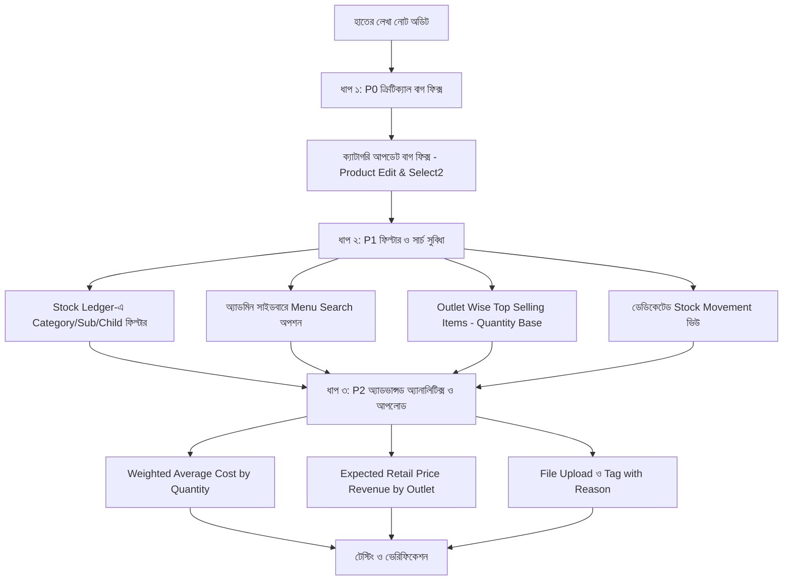

# 📋 B2B Viking ERP — রিকোয়ারমেন্ট ও বাগ অ্যানালাইসিস পূর্ণাঙ্গ রিপোর্ট
**প্রজেক্ট:** Copenhagen Tourist Point (b2bviking.com) — B2B Viking ERP  
**তারিখ:** ২০ অক্টোবর ২০২৬  
**সূত্র:** ক্লায়েন্টের হাতের লেখা নোট (`WhatsApp Image 2026-10-15 at 5.50.59 PM.jpeg`)  
**ডকুমেন্ট লোকেশন:** `docs/B2B_VIKING_ERP_REQUIREMENTS_AND_BUG_ANALYSIS_REPORT_BN.md`  
**স্ট্যাটাস:** পর্যালোচনা সম্পন্ন (Ready for Implementation)

---

## 📌 ১. সারসংক্ষেপ (Executive Summary)

ক্লায়েন্টের পাঠানো হাতে লেখা নোটের ৯টি পয়েন্ট গভীরভাবে অডিট করে দেখা হয়েছে। এতে কিছু সিস্টেম বাগ, ফিল্টারিংয়ের সীমাবদ্ধতা এবং নতুন বিজনেস অ্যানালিটিক্স রিকোয়ারমেন্ট চিহ্নিত করা হয়েছে।

### 📊 সারসংক্ষেপ টেবিল (Summary Table)

| # | ইমেজের বিষয়বস্তু | শ্রেণিবিভাগ | প্রায়োরিটি | বর্তমান অবস্থা ও প্রভাব |
|:---|:---|:---:|:---:|:---|
| **১** | ** outlet wise top selling items - Quantity base** | Reporting & Analytics | **P1** | `admin/reports/best-sellers`-এ নির্দিষ্ট আউটলেট ফিল্টার নেই এবং র‍্যাংকিং অর্ডার সংখ্যা দিয়ে হচ্ছে, সর্বোচ্চ বিক্রিত কোয়ান্টিটি দিয়ে নয়। |
| **২** | **  tag with reason** *(বা pay with reason)* | Workflow / Field | **P1** | পেমেন্ট ভাউচার অথবা কাস্টমার/অর্ডার স্পেশাল ফ্ল্যাগিং-এ বাধ্যতামূলক **Reason Code** ড্রপডাউন ও নোট ফিল্ড নিশ্চিত করা। |
| **৩** | **\* Stock Ledger -> cate, sub, child wise filter** | Inventory Enhancement | **P1** | `admin/stock-ledger`-এ ক্যাটাগরি, সাব-ক্যাটাগরি ও চাইল্ড-ক্যাটাগরি ফিল্টার নেই; দ্রুত মালামাল খুঁজতে ক্যাসকেডিং ড্রপডাউন প্রয়োজন। |
| **৪** | **\* Menu Search option** | UI / Navigation UX | **P1** | সাইডবারে ৬০+ মেনু আইটেম রয়েছে। শীর্ষে লাইভ **Instant Menu Search** অপশন দিলে ইউজার ১ সেকেন্ডে মেনু খুঁজে পাবে। |
| **৫** | ** pc wise and Average by quantity** | Procurement Analytics | **P2** | পারচেজ রিপোর্টে সাধারণ গড় (`AVG(unit_cost)`)-এর বদলে কোয়ান্টিটি ভিত্তিক **Weighted Average Cost** এবং পিস/আইটেমভিত্তিক সঠিক হিসাব। |
| **৬** | ** File upload** | Document Management | **P2** | পারচেজ অর্ডার (PO), ভেন্ডর বিল এবং পেমেন্ট ভাউচারে সাপোর্টিং ডকুমেন্টস (Challan, Vendor Invoice, Bank Slip) আপলোড ও প্রিভিউ। |
| **৭** | **\* Expected -> Retail price wise - user/outlet** | Inventory Valuation | **P2** | স্টক রিপোর্টে আউটলেট ও ইউজার ফিল্টার অনুযায়ী বিক্রয়মূল্যে (Retail MSRP) **Expected Potential Revenue & Profit** হিসাব। |
| **৮** | **\* Category not show after update product** | **Critical Bug** | **P0** | প্রোডাক্ট এডিট ফর্মে ক্যাটাগরি পরিবর্তনের সময় Select2 ড্রপডাউন ডমে রি-রেন্ডার না হওয়ায় আপডেট করার পর ক্যাটাগরি হারিয়ে যায়। |
| **৯** | **\* movement stock** | Inventory Tracking | **P1** | সাইডবারে ডেডিকেটেড **Stock Movement History** ভিউ যুক্ত করা, যাতে সব প্রোডাক্টের ইন/আউট গতিবিধি এক নজরে দেখা যায়। |

---

## 🔍 ২. বিস্তারিত টেকনিক্যাল বিশ্লেষণ ও সমাধান পরিকল্পনা

---

### মডিউল ১: Outlet Wise Top Selling Items — Quantity Base
* **বর্তমান অবস্থা:**
  * কন্ট্রোলার: `app/Http/Controllers/Backend/ReportController.php` (`bestSellers` মেথড)
  * ভিউ: `resources/views/backend/reports/best_sellers.blade.php`
  * সমস্যা: বর্তমানে সেলস ডেটা সব আউটলেটের সম্মিলিত অর্ডার থেকে আসে। কোনো নির্দিষ্ট শাখা বা স্টোরের জন্য আলাদা করার ড্রপডাউন নেই। এছাড়া টেবিলটি `times_ordered` দিয়ে সর্ট হয়।
* **সমাধান:**
  1. `admin/reports/best-sellers` ফিল্টারে একটি **"Select Outlet"** ড্রপডাউন যোগ করা।
  2. কোয়ারিতে ইউজার বা অর্ডারের আউটলেট আইডি দিয়ে ফিল্টারিং করা:
     ```php
     if ($request->filled('outlet_id')) {
         $query->whereHas('order', function($q) use ($request) {
             $q->where('outlet_id', $request->outlet_id)
               ->orWhereHas('user', fn($uq) => $uq->where('outlet_id', $request->outlet_id));
         });
     }
     ```
  3. সর্টিং অ্যালগরিদম বাধ্যতামূলকভাবে **Quantity Based** (`total_qty DESC`) করা:
     ```php
     $query->orderByDesc('total_qty')->orderByDesc('times_ordered');
     ```
* **প্রভাবিত ফাইল:**
  * `app/Http/Controllers/Backend/ReportController.php`
  * `resources/views/backend/reports/best_sellers.blade.php`
  * `resources/views/backend/reports/partials/best_sellers_table.blade.php`

---

### মডিউল ২:  Tag With Reason (বা Pay With Reason)
* **বর্তমান অবস্থা:**
  * পেমেন্ট ও অর্ডার ট্রানজ্যাকশনে সাধারণ ঐচ্ছিক `note` ফিল্ড রয়েছে, কিন্তু সুনির্দিষ্ট অডিট-যোগ্য "Reason / Purpose" কোড নেই।
* **সমাধান:**
  1. **পেমেন্টের ক্ষেত্রে (Payment with Reason):**
     * কাস্টমার ও ভেন্ডর পেমেন্ট ফর্মে একটি ড্রপডাউন:
       * `Advance Payment`
       * `Regular Invoice Settlement`
       * `Partial Payment`
       * `Damaged / Return Compensation`
       * `Adjustment / Discount Settle`
       * `Other (Specify Reason)`
  2. **ট্যাগিং ও হোল্ডের ক্ষেত্রে (Tag with Reason):**
     * কাস্টমার ক্রেডিট লক বা অর্ডার অন-হোল্ড করার সময় একটি বাধ্যতামূলক রিজন মোডাল চালু করা।
* **প্রভাবিত ফাইল:**
  * `app/Http/Controllers/Backend/AccountController.php`
  * `resources/views/backend/accounts/`
  * `database/migrations/`

---

### মডিউল ৩: \* Stock Ledger -> Category, Sub & Child Category Wise Filter
* **বর্তমান অবস্থা:**
  * কন্ট্রোলার: `app/Http/Controllers/Backend/StockLedgerController.php`
  * ভিউ: `resources/views/backend/stock_ledger/index.blade.php`
  * সমস্যা: বর্তমান ফিল্টারে শুধু `Product`, `Variant`, `Reference`, `Movement Type`, `Date` আছে। কোনো ক্যাটাগরিভিত্তিক ফিল্টার নেই।
* **সমাধান:**
  1. লেজার ইনডেক্স পেজে ৩টি ক্যাসকেডিং ড্রপডাউন যুক্ত করা:
     * `Category`
     * `Sub Category`
     * `Child Category`
  2. এজাক্স ইভেন্টের মাধ্যমে ক্যাটাগরি পরিবর্তনের সাথে সাথে সংশ্লিষ্ট সাব ও চাইল্ড ক্যাটাগরি লোড হবে।
  3. `StockLedgerController.php`-এ কুয়েরি আপডেট:
     ```php
     if ($request->filled('category_id')) {
         $data->whereHas('product', fn($q) => $q->where('category_id', $request->category_id));
     }
     if ($request->filled('sub_category_id')) {
         $data->whereHas('product', fn($q) => $q->where('sub_category_id', $request->sub_category_id));
     }
     if ($request->filled('child_category_id')) {
         $data->whereHas('product', fn($q) => $q->where('child_category_id', $request->child_category_id));
     }
     ```
* **প্রভাবিত ফাইল:**
  * `app/Http/Controllers/Backend/StockLedgerController.php`
  * `resources/views/backend/stock_ledger/index.blade.php`

---

### মডিউল ৪: \* Menu Search Option
* **বর্তমান অবস্থা:**
  * ফাইল: `resources/views/backend/layouts/navbar.blade.php`
  * সমস্যা: সাইডবারে মেনুর সংখ্যা ৬০টির বেশি। স্ক্রোল করে নির্দিষ্ট সাব-মেনু খুঁজে বের করা ধীরগতির ও কষ্টকর।
* **সমাধান:**
  1. সাইডবারের ব্র্যান্ড হেডারের ঠিক নিচে একটি কুইক সার্চ ইনপুট ফিল্ড বসানো:
     ```html
     <div class="sidebar-search-box p-3">
         <input type="text" id="admin-menu-search" class="form-control form-control-sm" placeholder="🔍 Search menu (Ctrl+K)...">
     </div>
     ```
  2. জাভাস্ক্রিপ্ট দিয়ে রিয়েল-টাইম ফিল্টারিং:
     * ব্যবহারকারী টাইপ করলেই অমিল মেনুগুলো ফেড-আউট হবে।
     * মিলে যাওয়া মেনুর প্যারেন্ট একর্ডিয়ন অটোমেটিক ওপেন হবে এবং সার্চ টেক্সট হাইলাইট হবে।
* **প্রভাবিত ফাইল:**
  * `resources/views/backend/layouts/navbar.blade.php`
  * `resources/views/backend/layouts/master.blade.php`

---

### মডিউল ৫: ⑭ PC Wise and Average by Quantity
* **বর্তমান অবস্থা:**
  * ফাইল: `app/DataTables/ItemWisePurchaseDataTable.php`
  * সমস্যা: লাইব্রেরিতে বর্তমানে `AVG(purchase_details.unit_cost)` কুয়েরি ব্যবহার করা হচ্ছে। এটি সাধারণ গাণিতিক গড়, যা ভুল খরচ দেখায়।
    * *উদাহরণ:* ১০ পিস ১০ টাকায় কিনলে এবং ১০০০ পিস ৫ টাকায় কিনলে সরল গড় দেখাবে ৭.৫০ টাকা; কিন্তু প্রকৃত গড় খরচ ৫.০৫ টাকা।
* **সমাধান:**
  1. কোয়ান্টিটি ভিত্তিক **Weighted Average Cost Formula** ইমপ্লিমেন্ট করা:
     $$\text{True Weighted Average Cost} = \frac{\sum (\text{unit\_cost} \times \text{qty})}{\sum \text{qty}}$$
  2. ডাটাটেবিলে একক পিস (Piece/PC) ভিত্তিক ক্রয় হিস্ট্রি এবং গড় কোয়ান্টিটি অর্ডার ব্রেকডাউন কলাম যোগ করা।
* **প্রভাবিত ফাইল:**
  * `app/DataTables/ItemWisePurchaseDataTable.php`
  * `app/Services/PurchaseReportService.php`

---

### মডিউল ৬: ⑮ File Upload
* **বর্তমান অবস্থা:**
  * বিভিন্ন ফর্ম ও মডিউলে ডকুমেন্টস অ্যাটাচমেন্টের জায়গা সীমিত।
* **সমাধান:**
  1. **Purchase Order (PO) & GRN:** চালানের ছবি, প্যাকিং স্লিপ বা ভেন্ডর ইনভয়েস পিডিএফ আপলোডের জন্য ড্র্যাগ-অ্যান্ড-ড্রপ জোন।
  2. **Payment Receipts:** ব্যাংক স্লিপ, চেক বা ক্যাশ মেমোর স্ন্যাপশট আপলোড ও এক ক্লিকে দেখার ব্যবস্থা।
* **প্রভাবিত ফাইল:**
  * `resources/views/backend/purchase/po_show.blade.php`
  * `resources/views/backend/accounts/`
  * `app/Http/Controllers/Backend/AccountController.php`

---

### মডিউল ৭: \* Expected -> Retail Price Wise - User/Outlet
* **বর্তমান অবস্থা:**
  * ফাইল: `app/Http/Controllers/Backend/ReportController.php` (`stockReport` মেথড)
  * ফাইল: `resources/views/backend/reports/stock.blade.php`
  * সমস্যা: স্টক রিপোর্টে সম্ভাব্য রেভিনিউ (`potential_revenue`) হিসাব করা হয় গ্লোবালি: `SUM(inventory_stocks.quantity * products.price)`। এখানে কোনো আউটলেট বা ইউজার অনুযায়ী হিসাব করার ফিল্টার নেই।
* **সমাধান:**
  1. স্টক রিপোর্টের ফিল্টারে **"Outlet / User"** ড্রপডাউন যুক্ত করা।
  2. নির্দিষ্ট আউটলেট সিলেক্ট করলে শুধুমাত্র সেই আউটলেটের অন-হ্যান্ড স্টকের ওপর রিটেইল বিক্রয়মূল্য (MSRP) দিয়ে **Expected Potential Revenue & Gross Margin** গণনা করা।
* **প্রভাবিত ফাইল:**
  * `app/Http/Controllers/Backend/ReportController.php`
  * `resources/views/backend/reports/stock.blade.php`
  * `resources/views/backend/reports/partials/stock_table_rows.blade.php`

---

### মডিউল ৮: \* Category Not Show After Update Product (Critical Bug Fix)
* **রুটেড সমস্যা (Root Cause Analysis):**
  1. ফাইল: `resources/views/backend/product/edit.blade.php` (লাইন ৩৮৮-৪২৮)
  2. এডিট পেজে যখন ব্যবহারকারী ক্যাটাগরি পরিবর্তন করে, তখন জাভাস্ক্রিপ্ট এজাক্স দিয়ে সাব-ক্যাটাগরি অপশনগুলো ডমে যোগ করে (`$('.sub-category').html(...)`), কিন্তু **Select2 প্লাগইন রি-ইনিশিয়ালাইজ বা `.trigger('change')` করা হয় না**। ফলে Select2 পুরনো ক্যাশ ধরে রাখে বা ফাঁকা ড্রপডাউন দেখায়।
  3. ফর্ম সাবমিট করার সময় `category_id` বা `sub_category_id` ফিল্ডটি মিসম্যাচ হয়ে ডাটাবেজে নাল বা আপডেট ব্যর্থ হয়, ফলে প্রোডাক্ট গ্রিডে ও ডাটাটেবিলে ক্যাটাগরি `Uncategorized` হয়ে যায়।
* **সমাধান:**
  1. `edit.blade.php`-এর এজাক্স সাকসেস ব্লকে Select2 রি-ইনিশিয়ালাইজ করা:
     ```javascript
     $('.sub-category').select2({ width: '100%' }).trigger('change');
     ```
  2. [ProductController.php](file:///home/agent47/Sites/b2bvikingERP/app/Http/Controllers/Backend/ProductController.php)-এর `update()` মেথডে ক্যাটাগরি, সাব-ক্যাটাগরি ও চাইল্ড-ক্যাটাগরি অ্যাসাইনমেন্ট সুরক্ষিত করা এবং ক্যাশ ক্লিয়ার করা।
* **প্রভাবিত ফাইল:**
  * `resources/views/backend/product/edit.blade.php`
  * `app/Http/Controllers/Backend/ProductController.php`

---

### মডিউল ৯: \* Movement Stock
* **বর্তমান অবস্থা:**
  * প্রোডাক্ট ইনডেক্স পেজে প্রোডাক্ট-ভিত্তিক একটি মোডাল রয়েছে (`admin/products/{id}/stock-movement`), কিন্তু সমগ্র ওয়্যারহাউস ও আউটলেটের গ্লোবাল স্টক মুভমেন্ট এক নজরে দেখার জন্য সাইডবারে কোনো সেন্ট্রালাইজড পেজ নেই।
* **সমাধান:**
  1. সাইডবারের **Inventory** সেকশনে একটি নতুন মেনু যুক্ত করা: **"Stock Movement History"** (`admin.inventory.stock-movements`)।
  2. সেখানে সব পণ্যের আগমন ও নির্গমন (Purchase In, Sale Out, Transfer, Damage Adjustment, Return) তারিখ, ব্যাচ, এবং আউটলেট অনুযায়ী ফিল্টার করে রিয়েল-টাইম দেখা যাবে।
* **প্রভাবিত ফাইল:**
  * `routes/web.php`
  * `app/Http/Controllers/Backend/StockLedgerController.php`
  * `resources/views/backend/layouts/navbar.blade.php`
  * `resources/views/backend/inventory/movement_history.blade.php`

---

## 🛠️ ৩. বাস্তবায়ন রোডম্যাপ ও অ্যাকশন প্ল্যান (Implementation Roadmap)



### কার্যপরিকল্পনার ধাপসমূহ:
* **পর্যায় ১ (তাৎক্ষণিক বাগ ফিক্স):** `Category not show after update product` সমস্যার ১০০% সমাধান।
* **পর্যায় ২ (সার্চ ও ফিল্টার):** `Menu Search` এবং `Stock Ledger Category Cascading Filter` ইমপ্লিমেন্টেশন।
* **পর্যায় ৩ (রিপোর্ট ও ভ্যালুয়েশন):** `Top Selling Items (Outlet wise & Quantity base)` এবং `Expected Retail Price Valuation (Outlet wise)` আপডেট।
* **পর্যায় ৪ (অ্যাকাউন্টিং ও ডকুমেন্টস):** `Average by Quantity` এবং `File Upload / Tag with Reason` সংযুক্তকরণ।

---
*রিপোর্ট প্রস্তুতকারক: Antigravity AI Pair Programmer & Engineering Team*  
*প্রজেক্ট কোডবেস: `/home/agent47/Sites/b2bvikingERP`*
